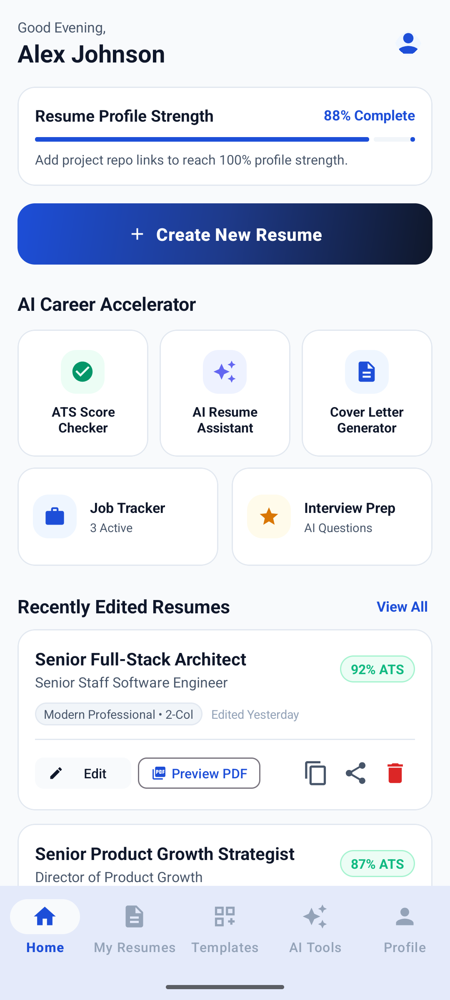
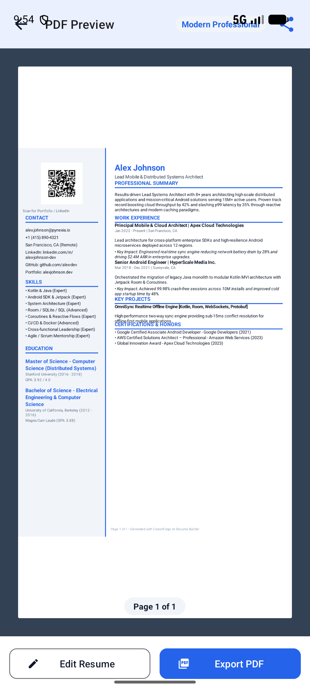
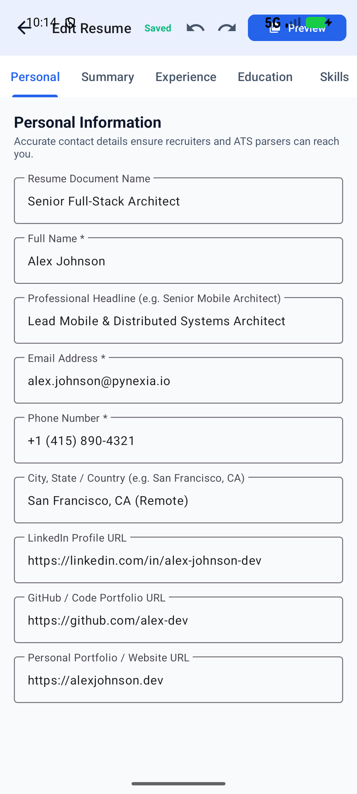
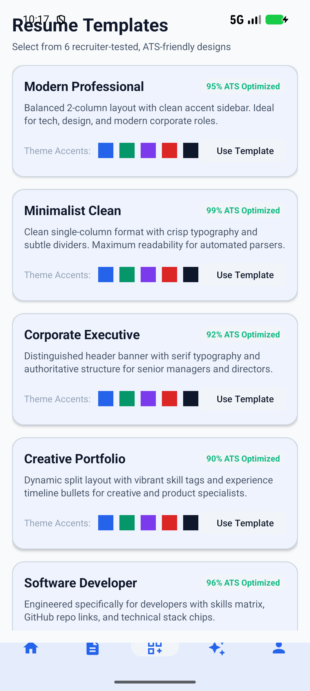
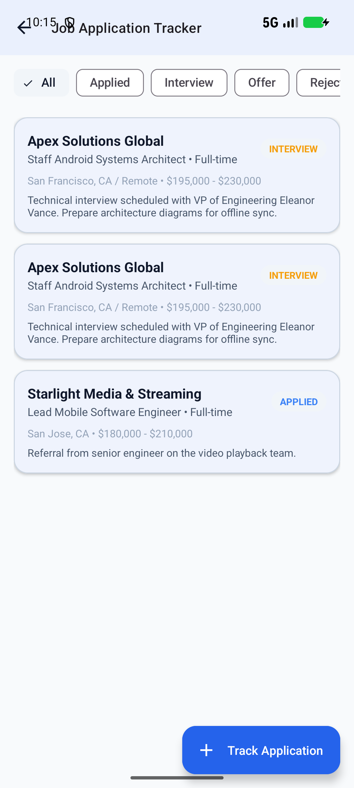
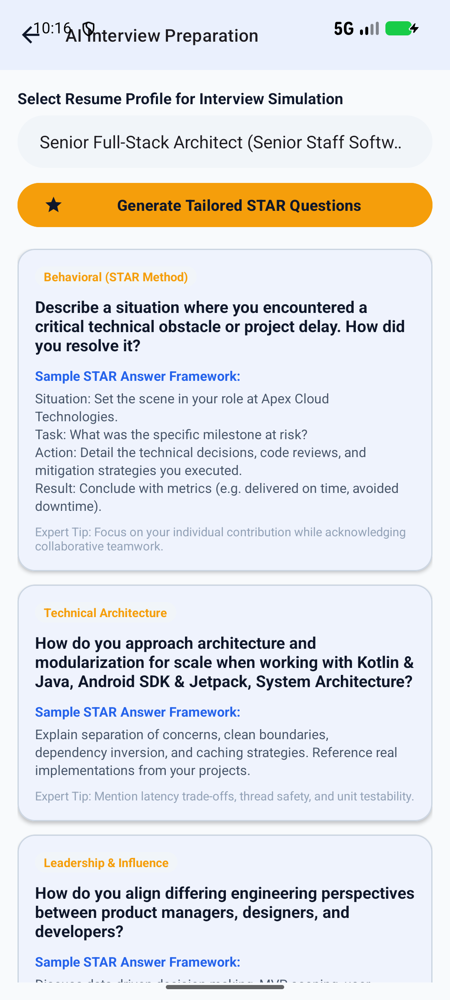

# CareerForge AI — Next-Generation AI Resume Builder & Career Suite

[](https://www.android.com/)
[](https://kotlinlang.org/)
[](#architecture)
[-F59E0B.svg?style=flat&logo=sqlite)](https://developer.android.com/training/data-storage/room)
[](https://m3.material.io/)
[](LICENSE)

> **CareerForge AI** is a commercial-grade, privacy-conscious, offline-first Android platform designed to help students, freshers, and experienced professionals create high-converting, ATS-compliant resumes, craft AI-powered cover letters, prepare for interviews, and track job applications.

---

## 📸 Visual Showcase

| ATS Resume Analyzer | Vector PDF Preview | Live Resume Editor |
| :---: | :---: | :---: |
|  |  |  |

| Templates Gallery | Job Application Tracker | AI Interview Prep |
| :---: | :---: | :---: |
|  |  |  |

---

## 🌟 Key Features

### 1. 🎯 Advanced ATS Compatibility Engine (0–100%)
* **Job Description Keyword Matching**: Paste any target job posting to compare keywords, skills, and hard competencies.
* **Quantified Metric Bullet Detector**: Audits bullet points against the Google XYZ formula (*Accomplished [X] measured by [Y] by doing [Z]*).
* **Section-by-Section Completeness**: Instant diagnostics for Contact Info, Summary, Experience, Education, and Skills.
* **Deterministic Scoring Algorithm**: Evaluates readability, typography, keyword density, and structural parsing compatibility.

### 2. 🖨️ Native Vector PDF Generation Engine
* **Direct Vector Rendering**: Resumes are drawn using Android's native `android.graphics.pdf.PdfDocument` canvas — 100% extractable Unicode text, not low-res raster images.
* **Clickable Hyperlinks**: Direct `mailto:`, LinkedIn, GitHub, and Portfolio URLs embedded into the document stream.
* **Multi-Page & Page Breaks**: Intelligent element flow preventing orphaned section headers.
* **Zero Dependency on WebViews or Cloud APIs**: Generates print-ready A4/Letter PDFs in milliseconds without internet access.

### 3. 🎨 Executive Template Architecture
* **6 Specialized Layout Categories**: Modern Pro, Corporate Executive, Minimalist, Academic / Fresher, Tech Software Developer, and Creative.
* **Palette & Typography Switcher**: Custom color theming (Electric Sapphire, Emerald, Obsidian, Purple, Crimson, Amber) and typography controls.
* **Dual Theme Engine**: Seamless support for Executive Slate (Light Mode) and OLED Midnight (Dark Mode) with one-tap toggle.

### 4. 🤖 AI Career Accelerator Suite
* **AI Bullet Point Polish**: Enhances weak job descriptions into impact-driven action statements.
* **Cover Letter Generator**: Auto-tailors professional cover letters from resume metadata and specific target company roles.
* **Interview Question Prep**: Simulates role-specific behavioral (STAR method) and technical interview questions.
* **Custom AI Endpoint**: Works fully offline with local heuristics by default, with optional bring-your-own-key (BYOK) OpenAI/Gemini API integration.

### 5. 💼 Job Application Tracker
* **Application Lifecycle Pipeline**: Track opportunities across *Interested*, *Applied*, *Assessment*, *Interview*, *Offer*, and *Rejected*.
* **Salary & Recruiter Records**: Attach recruiter contact details, expected compensation, and follow-up reminders.
* **Direct Resume Linking**: Connect each job application to the specific tailored resume version used.

### 6. 🔒 100% Offline-First Privacy & Security
* **Zero Cloud Scraping**: All personal identifiable information (PII), work history, and contact numbers remain on your local device.
* **Room SQLite Encryption Ready**: Structured local database persistence with asynchronous Kotlin Coroutines and Flows.
* **1-Click JSON Backup & Export**: Easily export your entire career profile for portable backup.

---

## 🛠️ Technology Stack

| Layer | Technology |
| :--- | :--- |
| **Language** | Kotlin 2.0+ (100% Coroutines & Flow) |
| **Architecture** | MVVM (Model-View-ViewModel) + Repository Pattern |
| **UI System** | Material Design 3 (M3), XML Layouts, ViewBinding |
| **Local Storage** | Room Database (SQLite), AndroidX PreferenceManager |
| **PDF Generation** | Native Android Vector Canvas (`android.graphics.pdf.PdfDocument`) |
| **PDF Rendering** | `android.graphics.pdf.PdfRenderer` |
| **Window Insets** | Android 15+ Edge-to-Edge (`ViewCompat.setOnApplyWindowInsetsListener`) |
| **Build Tooling** | Gradle 8.9 / AGP 8.7.3, KSP |

---

## 📂 Project Architecture

```
com.pynexia.resumebuilder/
├── CareerForgeApp.kt           # Application class & DI container
├── data/
│   ├── database/               # Room DB, DAOs, Converters & Seeder
│   ├── model/                  # ResumeData, Entities, Section Models
│   └── repository/             # Offline repositories (Resume, Jobs, User)
├── pdf/
│   ├── PdfGenerator.kt         # Native vector canvas drawing engine
│   └── TemplateStyles.kt       # Spacing, typography & margin specs
├── ui/
│   ├── home/                   # Home Dashboard & Career Accelerator
│   ├── resumes/                # Resume library, duplication & management
│   ├── editor/                 # Multi-step live resume editor & autosave
│   ├── preview/                # PDF preview & system print/share sheet
│   ├── ats/                    # Real-time ATS compatibility engine
│   ├── templates/              # Professional template showcase & colors
│   ├── coverletter/            # Cover letter generator & editor
│   ├── jobs/                   # Kanban job application tracker
│   ├── aitools/                # AI Interview Prep & Resume Comparator
│   ├── profile/                # Master user profile & data backup
│   └── settings/               # Dark mode & custom AI endpoint config
└── utils/
    ├── PreferenceManager.kt    # SharedPreferences wrapper
    └── ViewExtensions.kt       # System bar insets & edge-to-edge padding
```

---

## 🚀 Getting Started

### Prerequisites
* Android Studio Hedgehog (2023.1.1) or newer
* JDK 17
* Android SDK (API Level 26 minimum, API 36 target)

### Building from Source

```bash
# Clone the repository
git clone https://github.com/sanjayBairw/CareerForgeAI.git
cd CareerForgeAI

# Build the debug APK
./gradlew assembleDebug

# Install on a connected device/emulator
adb install -r app/build/outputs/apk/debug/app-debug.apk
```

---

## 📄 License

Distributed under the MIT License. See `LICENSE` for more information.
